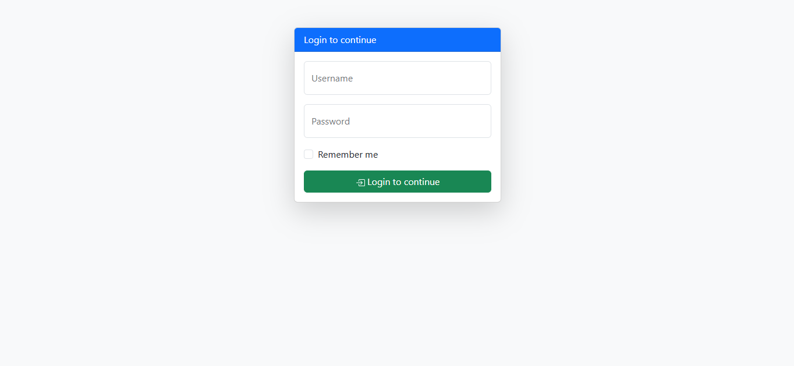
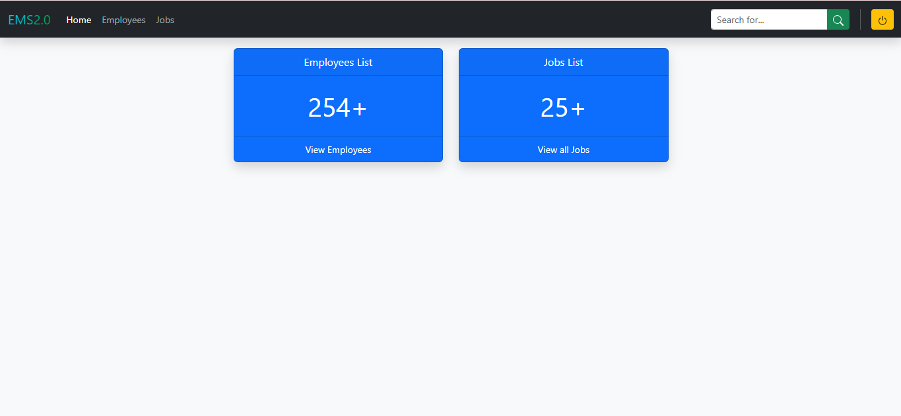
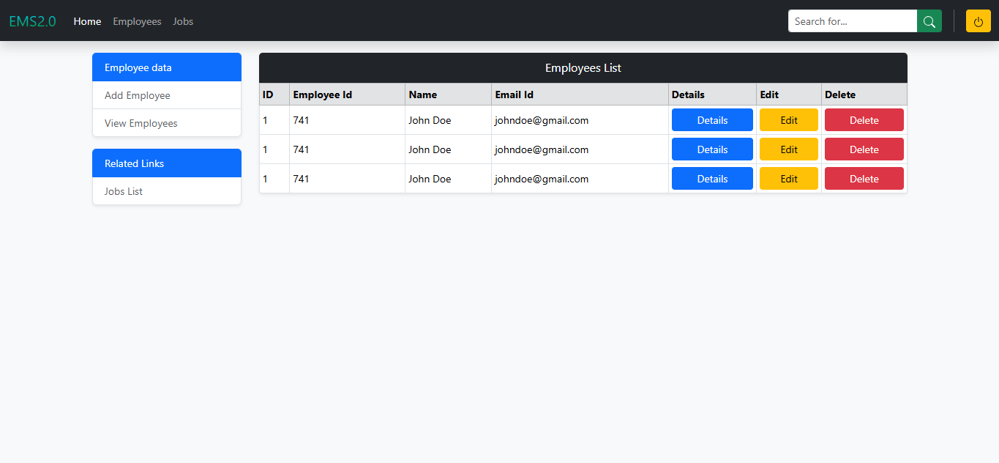
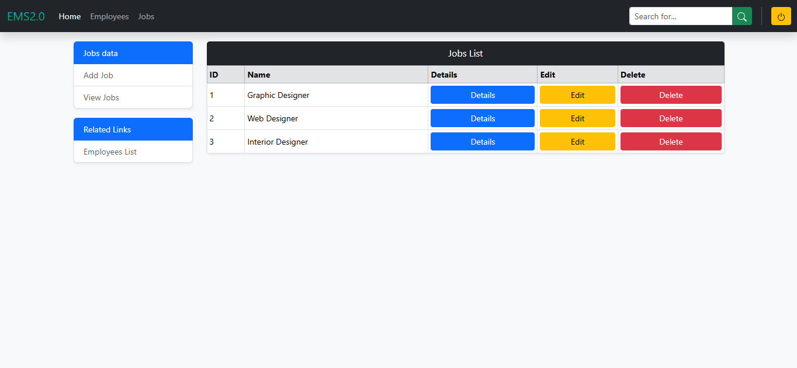

# 🏢 EMS 2.0 - Employee Management System Web Portal

A clean, responsive, and modern Employee Management System (EMS) front-end web dashboard built with **HTML5**, **Bootstrap 5**, and **CSS3**. EMS 2.0 provides an intuitive administrative dashboard to manage company personnel, job roles, and organizational workflows.

---

## 📌 Table of Contents

- [Overview](#-overview)
- [Key Features](#-key-features)
- [UI Screenshots](#-ui-screenshots)
- [Tech Stack](#-tech-stack)
- [Project Structure](#-project-structure)
- [Getting Started](#-getting-started)
- [Pages & Workflows](#-pages--workflows)
- [Future Enhancements](#-future-enhancements)
- [Author](#-author)
- [License](#-license)

---

## 🚀 Overview

**EMS 2.0** is designed for Human Resources (HR) teams and administrators to easily track company personnel, manage job designations, and navigate employee records. The interface features a sleek dark navigation system, animated gradient branding, metric summary cards, and interactive modal-driven CRUD interfaces.

---

## ✨ Key Features

- **🔐 Modern Authentication UI**: Clean, card-based login interface with floating label inputs and remember-me functionality.
- **📊 Interactive Dashboard**: Quick-glance statistical summary cards displaying total employee count and active job listings.
- **👥 Employee Directory & CRUD**:
  - Tabular view of employee records (ID, Employee Code, Full Name, Email).
  - **Add Employee**: Modal form capturing name, contact details, date, and job role assignment.
  - **View Details**: Clean modal breakdown of individual employee records.
  - **Edit Employee**: Pre-populated modal form to update employee information.
  - **Delete Confirmation**: Safe confirmation dialog before removing records.
- **💼 Job Roles Management**:
  - Organized listing of department roles and designations.
  - Dedicated modals for adding new positions, viewing specifications, updating titles, and confirming deletions.
- **🎨 Polished UI & UX**:
  - Built with **Bootstrap 5.3.8** utilities and grid system.
  - Glassmorphic modal backdrops (`backdrop-filter: blur(5px)`).
  - Crisp, lightweight inline **Bootstrap SVG Icons**.
  - Vibrant linear-gradient brand accents.
  - Fully mobile-responsive layout for desktop, tablet, and mobile browsers.

---

## 📸 UI Screenshots

<div align="center">

### 1. Login Screen
*Clean floating label authentication card*
<br><br>


<br><br>

### 2. Main Dashboard
*Overview portal with metric counters and quick navigation*
<br><br>


<br><br>

### 3. Employee Management
*Comprehensive personnel directory with action modals (Details, Edit, Delete, Add)*
<br><br>


<br><br>

### 4. Jobs & Roles Management
*Designation directory with CRUD operations and interactive modals*
<br><br>


</div>

---

## 🛠 Tech Stack

| Technology | Description |
| :--- | :--- |
| **HTML5** | Semantic markup structure |
| **CSS3** | Custom gradient branding, responsive tweaks, and modal backdrop blurring |
| **Bootstrap 5.3.8** | Responsive layout grid, cards, forms, tables, and modal components |
| **Popper.js 2.11.8** | Tooltip and dropdown positioning engine |
| **Bootstrap Icons** | Scalable vector graphics (SVG) embedded for interface icons |

---

## 📂 Project Structure

```text
EMS-Web/
├── ReadmeImages/              # Visual assets for documentation
│   ├── emsLogIn.png          # Login page preview
│   ├── emsMain.png           # Dashboard view
│   ├── emsEmp.png            # Employees list & modal preview
│   └── emsJob.png            # Jobs list & modal preview
├── index.html                 # Entry point: User Login page
├── dash.html                  # Main administrative dashboard
├── employees-list.html        # Employee directory with CRUD modals
├── jobs-list.html             # Job designations with CRUD modals
└── README.md                  # Project documentation
```

---

## ⚡ Getting Started

### Prerequisites

No build tools, package managers, or server runtimes are required. All styling and scripts are served via reliable CDNs.

### Quick Launch

1. **Clone the repository:**
   ```bash
   git clone https://github.com/sajidsam/EMS-Web.git
   ```

2. **Navigate to the project folder:**
   ```bash
   cd EMS-Web
   ```

3. **Open in your browser:**
   - Simply double-click `index.html` to open it in any web browser.
   - Alternatively, serve it using VS Code **Live Server** extension or Python's built-in HTTP server:
     ```bash
     # Optional: Run a lightweight local server
     python -m http.server 3000
     ```
     Then navigate to `http://localhost:3000` in your browser.

---

## 🧭 Pages & Workflows

1. **Login (`index.html`)**:
   - Access the portal using the credentials form.
   - Submitting the form routes seamlessly to the main dashboard (`dash.html`).
2. **Dashboard (`dash.html`)**:
   - Central hub displaying real-time metrics (Employees: 254+, Jobs: 25+).
   - Top navigation bar with persistent search input, logout button, and direct links.
3. **Employees List (`employees-list.html`)**:
   - Left sidebar for rapid actions: *Add Employee*, *View Employees*, and shortcut to *Jobs List*.
   - Data table with direct modal triggers for **View Details**, **Edit Record**, and **Delete Confirmation**.
4. **Jobs List (`jobs-list.html`)**:
   - Left sidebar with job action shortcuts.
   - Data table tracking company job titles with full modal-based CRUD functionality.

---

## 🔮 Future Enhancements

- [ ] Connect with a backend API (Node.js/Express, Python/Django, or PHP/Laravel).
- [ ] Database integration (PostgreSQL / MySQL / MongoDB) for dynamic data persistence.
- [ ] Role-based access control (Admin, HR Manager, Standard Employee).
- [ ] Client-side search and live filtering for employee and job tables.
- [ ] Pagination and CSV / Excel export functionality.
- [ ] Dark / Light theme toggle.

---

## 👤 Author

- **Sajidul Islam**
  - GitHub: [@sajidsam](https://github.com/sajidsam)
  - Email: [isajidul174@gmail.com](mailto:isajidul174@gmail.com)

---

## 📄 License

This project is open-source and available under the [MIT License](LICENSE).

